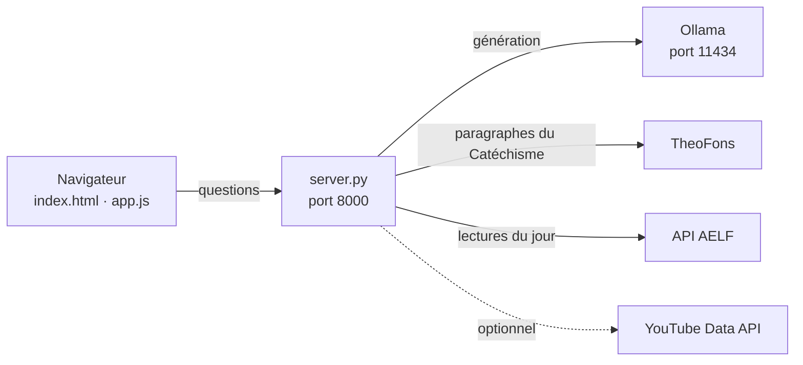

# IA Bible ✝️ — Agent IA catholique

> Un site bilingue (FR/EN) pour découvrir la Bible et la foi catholique, avec un assistant de questions-réponses de type **Agentic RAG** qui s'appuie sur le Catéchisme, les lectures liturgiques du jour (AELF) et un modèle de langage local (Ollama).


---

## ✨ Fonctionnalités

### 🤖 Assistant biblique et catholique
- Pose tes questions sur Jésus, un passage biblique, la prière, les sacrements ou l'enseignement de l'Église.
- Les réponses sont générées par un modèle local via **Ollama** (par défaut `gemma4:e2b`).
- Le serveur enrichit la réponse avec des **paragraphes du Catéchisme** (via TheoFons) et les **lectures du jour** (via l'AELF) quand la question s'y rapporte.
- Actions sur chaque réponse : copier, partager, mettre en favori, poursuivre avec des questions suggérées.

### 📖 Lecture et liturgie
- **Lecteur biblique** AELF : choix du livre et du chapitre, navigation précédent/suivant, ouverture directe sur AELF.
- **Lectures liturgiques du jour** et **verset du jour** (Holy Bible API, avec repli sur l'AELF).
- **Calendrier liturgique** : prochaines fêtes, dates mobiles calculées à partir de Pâques, explication au clic.
- **Parcours de lecture** sur sept jours et recherche web limitée aux pages AELF.

### 🙏 Prière et pratique
- **Prières à connaître** (Je crois en Dieu, Je confesse à Dieu, etc.) avec texte et liens de référence.
- **Louanges** : liste filtrable de chants et psaumes, avec recherche YouTube.
- **Quiz biblique**, intention de prière, favoris et historique récent.
- **Carte des églises** (Google Maps) : recherche par ville ou code postal, ou par géolocalisation sur demande.

### 🎨 Confort d'utilisation
- Interface en **français et anglais** (la langue des réponses de l'assistant suit celle de l'interface).
- Mode **clair / sombre**, taille du texte réglable, cinq couleurs de fond (sauge, rose, bleu, jaune, lavande).
- Affichage adapté à l'ordinateur et au téléphone.

---

## 🚀 Démarrage rapide

Deux modes d'utilisation :

| | **Aperçu statique** | **Version complète** |
|---|---|---|
| Installation | Aucune | Python + Ollama |
| Assistant IA génératif | ❌ (quelques réponses guidées intégrées) | ✅ |
| Prières, louanges, calendrier, lecteur biblique | ✅ | ✅ |
| Hébergement possible sur GitHub Pages | ✅ | ❌ (nécessite un serveur Python) |

### Aperçu sans installation

Ouvre `index.html` dans ton navigateur, ou publie les fichiers sur **GitHub Pages** (*Settings → Pages*). Les données externes dépendent de la disponibilité des API et des règles du navigateur.

> ⚠️ Cette version **ne lance ni Python ni Ollama** : l'assistant génératif n'y est pas disponible.

---

## 🛠 Installation complète (avec l'assistant IA)

### Prérequis

- [Git](https://git-scm.com/downloads)
- [Python 3](https://www.python.org/downloads/) — aucune dépendance à installer (`pip install` inutile)
- [Ollama](https://ollama.com/download) (Windows, macOS ou Linux)

### 1. Cloner le projet

```bash
git clone https://github.com/an-Steve/Agent-IA-Catholique.git
cd Agent-IA-Catholique
```

### 2. Démarrer Ollama et télécharger le modèle

Ollama doit rester actif pendant l'utilisation (API locale sur le port **11434**).

```bash
ollama list              # vérifie qu'Ollama répond
ollama serve             # seulement si Ollama ne répond pas (laisse ce terminal ouvert)
ollama pull gemma4:e2b   # téléchargement unique, quelques minutes
```

> Si `ollama serve` signale que le port 11434 est déjà utilisé, le service tourne déjà : tu peux continuer.

### 3. Lancer le site

Dans un **second terminal**, depuis le dossier du projet :

```bash
python server.py
```

(`Ctrl+C` pour arrêter.)

### 4. Ouvrir le site

Va sur **<http://127.0.0.1:8000>**.

> ⚠️ N'ouvre pas `index.html` directement si tu veux utiliser le modèle : l'assistant passe par le serveur (port **8000**), qui appelle Ollama (port **11434**).

```
Terminal 1 : ollama serve          → port 11434
Terminal 2 : python server.py      → port 8000  →  http://127.0.0.1:8000
```
Récapitylatif :
Terminale 1 :


Teminale 2 :


---

## ⚙️ Configuration

Toutes les options passent par des variables d'environnement, à définir **avant** `python server.py`.

| Variable | Rôle | Valeur par défaut |
|---|---|---|
| `OLLAMA_MODEL` | Modèle utilisé par l'assistant | `gemma4:e2b` |
| `OLLAMA_URL` | Adresse du serveur Ollama | `http://127.0.0.1:11434` |
| `PORT` | Port du site | `8000` |
| `HOST` | Interface d'écoute (`0.0.0.0` en hébergement) | locale |
| `YOUTUBE_API_KEY` | Active les résultats YouTube intégrés (facultatif) | — |

**Windows (PowerShell)**

```powershell
$env:PORT = "8080"
$env:YOUTUBE_API_KEY = "TA_CLE_API"
python server.py
```

**macOS / Linux**

```bash
PORT=8080 YOUTUBE_API_KEY="TA_CLE_API" python server.py
```

### Résultats YouTube intégrés (facultatif)

Sans clé, le bouton YouTube ouvre simplement une recherche sur YouTube. Avec une clé, jusqu'à cinq vidéos s'affichent sur le site.

1. Crée une clé dans Google Cloud et active **YouTube Data API v3** ([documentation](https://developers.google.com/youtube/registering_an_application)).
2. Définis `YOUTUBE_API_KEY` comme ci-dessus.

Le serveur limite l'usage à **80 recherches par jour** (le quota YouTube standard est de 100 appels `search.list` par jour — [détails](https://developers.google.com/youtube/v3/docs/search/list)).

> 🔐 Ne place jamais la clé dans `app.js`, dans le HTML ou dans le dépôt GitHub.

---

## 🧩 Architecture



Le serveur reçoit la question, récupère si possible des passages de référence (Catéchisme, lectures du jour), puis les transmet au modèle local pour produire la réponse.

---

## 🌍 Hébergement public

**GitHub Pages** ne peut héberger que la version statique : il n'exécute ni `server.py` ni Ollama. Pour que des visiteurs utilisent l'assistant sans rien installer :

1. Déploie `server.py` sur un hébergeur capable d'exécuter Python (`HOST=0.0.0.0`, `PORT` fourni par l'hébergeur).
2. Rends Ollama joignable **par ce serveur uniquement** (`OLLAMA_URL`). Ne rends **pas** le port 11434 public.
3. Si le site et le serveur sont sur des domaines différents, configure l'URL de l'API côté site.

Le backend limite le nombre de requêtes par adresse IP et ne conserve pas les conversations.

---

## 📁 Structure du projet

| Fichier | Rôle |
|---|---|
| `index.html` | Structure et contenu de la page |
| `style.css` | Mise en page, affichage mobile, thèmes clair/sombre |
| `app.js` | Langue, interface de discussion, ressources, calendrier, appels aux API publiques |
| `server.py` | Serveur web, connexion à Ollama, références documentaires, recherche YouTube facultative |
| `README.md` | Présentation et instructions |

---

## 📚 Sources et fiabilité

**Sources utilisées**

- [Bible AELF](https://www.aelf.org/bible) et [API AELF](https://api.aelf.org/) — textes et lectures liturgiques
- [Holy Bible API](https://holy-bible-api.com/docs/) — verset du jour (repli sur l'AELF)
- [TheoFons](https://theofons.net/la/api) — paragraphes du Catéchisme (corpus tiers, textes soumis aux droits de leurs ayants droit)
- [YouTube Data API](https://developers.google.com/youtube/v3/docs/search/list) — vidéos de louange (facultatif)
- Références officielles : [Catéchisme de l'Église catholique](https://www.vatican.va/archive/FRA0013/_INDEX.HTM), [Vatican](https://www.vatican.va/content/vatican/fr.html), [documents pontificaux](https://www.vatican.va/offices/papal_docs_list_fr.html)

> ⚠️ **Avertissement.** Le texte final est généré par un modèle de langage et peut contenir des erreurs. L'assistant ne remplace ni un prêtre, ni le Magistère, ni un accompagnement spirituel. Vérifie les citations et les questions doctrinales auprès des sources officielles.

## 🔒 Vie privée

- Favoris, intention de prière, taille du texte et historique sont stockés **uniquement dans le navigateur** (non synchronisés entre appareils). L'historique peut être effacé depuis la page.
- La position n'est **jamais demandée au chargement**. Si tu utilises la recherche autour de toi, les coordonnées servent uniquement à former la recherche envoyée à Google Maps. Tu peux aussi chercher une ville sans partager ta position.

---

## 🤝 Contribuer

Les suggestions et corrections sont les bienvenues : ouvre une *issue* ou une *pull request*. Pour tout contenu doctrinal, merci d'indiquer la source officielle correspondante.

## 📄 Licence

Projet réalisé par **Steve Anton Nelcon**. Licence : à définir (ajouter un fichier `LICENSE`, par exemple MIT).
